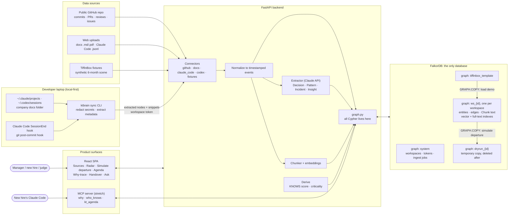

# KT Brain: System Architecture (high level)

_2026-10-15. Goes into the README as-is. To view it, paste the block into GitHub or https://mermaid.live._

## Storage: one database
FalkorDB is the only database. There is no Postgres and no blob store.
- **Entities and edges**, including `KNOWS` and `LEARNED`, are graph nodes and relationships.
- **Text** is stored as `Chunk` nodes linked in order by `NEXT`, so any document can be rebuilt from its chunks. Vector and full-text indexes sit on those same nodes.
- **Session logs are slimmed before storing.** We keep prompts, assistant text, file paths, branch and timestamps, and drop tool output and file dumps, which make up most of a JSONL file's size.
- **Originals:** PDFs are dropped after text extraction. With the CLI, raw logs never leave the laptop.
- **App metadata** (workspaces, tokens, ingest jobs) lives in a small `system` graph.

Add an object store (S3/R2) only if keeping originals becomes a requirement, or RAM cost per tenant gets too high. Even then it holds files, not a second database.
