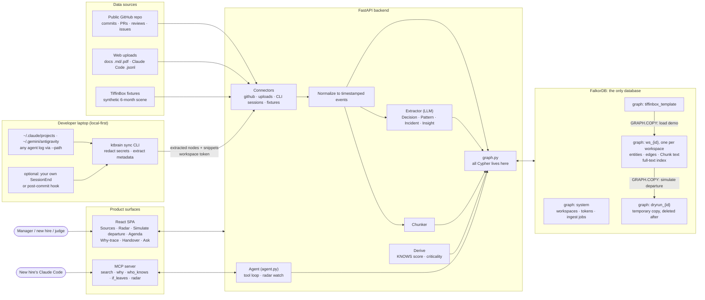
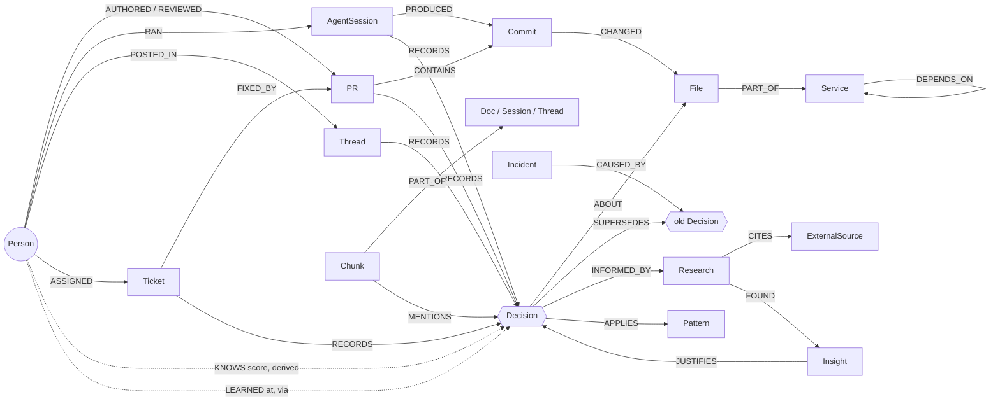

# KT Brain

**🔗 Live demo: [kt-brain-devs.vercel.app](https://kt-brain-devs.vercel.app/)** · Sign in as `admin@tiffinbox.example` / `demo123`

**Knowledge transfer is a coverage problem, not a Q&A problem.**
KT Brain shows which knowledge is about to leave your company with a departing teammate, shows that nobody else has a recorded copy of it, and counts the handover down to zero.

> Built for **WeMakeDevs × FalkorDB "Graph Hacks: Context for AI Agents"** (Oct 15–18, 2026).
> Tracks: **03 Company Brain** · **02 Agent Memory & Coordination** · **01 Agents That Act on Connected Data**

---

## The problem

When a developer leaves a startup, the team does **KT (knowledge transfer)**. Sometimes it's a one-hour call, sometimes a few weeks, depending on how busy both people are. After a layoff, it's often a rushed call on the last day.

Six months later, the new developer changes a payment retry count from 7 to 3 and payments start failing. The reason it was 7 was spread across a chat thread, a ticket and a Claude Code session that nobody remembered.

**KT fails because nobody knows what's missing.** A chatbot can answer the questions you think to ask. It can't tell you which questions you didn't know to ask.

- 68% of developers hit a knowledge silo at least once a week ([Stack Overflow 2022](https://stackoverflow.blog/2022/06/22/asked-and-answered-the-results-for-the-2022-developer-survey-are-here/)).
- Newcomers take considerable time to match a departing core developer, and more orphaned code goes with more defects ([arXiv 2207.12851](https://arxiv.org/pdf/2207.12851)).

## The idea

KT Brain starts recording **from the first day** a person joins, not at their exit interview. Commits, PRs, reviews, tickets, docs, design decisions, incident write-ups, product research and **AI coding sessions** (Claude Code, Antigravity, or any agent's logs) all go into a **FalkorDB knowledge graph**. When someone leaves, nothing has to be pulled out of them at the last minute, because the graph already holds it.

| | What it does | How the graph does it |
|---|---|---|
| 1 | **Who knows what**: bus-factor radar while everyone is still here | Derived `KNOWS` edges; services and decisions with exactly one knower |
| 2 | **Dry-run a departure** before it happens | `GRAPH.COPY` the workspace, deactivate the leaver on the copy, list everything with **zero other knowers**. That list is the KT agenda |
| 3 | **Why-trace**: "why is `retries = 7`?" | A cited path: file ← commit ← AI session ← ticket ← chat thread, with research links |
| 4 | **Handover tracker** | KT sessions and the new hire's PRs add `LEARNED` edges; the agenda counts **N → 0** |
| 5 | **Inheritance** | The new hire's coding agent calls `why(path)` over MCP before editing a file |
| 6 | **An agent that acts on its own** | Every minute it watches each company's radar. A new item only one person knows gets an alert and a KT brief, with no human click |

It also flags **combination risk**: knowledge that is safe while either of two people stays, but disappears if both leave.

---

## The demo: TiffinBox (a synthetic startup)

TiffinBox is a fictional meal-subscription startup with one person per function. Its **6 months of history** (Apr → Sep 2026) are synthetic, written from a story bible that has a planted answer key (`COMPANY-X-SCENARIO.md`).

| Person | Role | Fate |
|---|---|---|
| Kavya | Frontend | stays |
| Arjun | Backend (payments, orders, auth) | **resigns** |
| Priya | DevOps (CI/CD, Terraform, secrets, backups) | **resigns** |
| Rohan | AI/ML (recommendations, ETA model) | stays |
| Neha | Product manager (PRDs, research, ADRs) | stays |
| Meera | New backend developer | **joins** for a one-week overlap |

The history covers four kinds of knowledge:
- **Code history**: commits, PRs and reviews across `web/`, `api/`, `infra/`, `ml/` and `docs/`.
- **Failure → research → improvement**: a checkout outage after an all-at-once deploy leads to research (citing Cloudflare's public [2 Jul 2019 outage report](https://blog.cloudflare.com/details-of-the-cloudflare-outage-on-july-2-2019/)) and then to **canary deploys**. Untested backups lead to research (citing GitLab's public [31 Jan 2017 incident](https://about.gitlab.com/blog/2017/02/10/postmortem-of-database-outage-of-january-31/)) and then to **quarterly restore tests**.
- **System design patterns**: retry with backoff, idempotency keys, optimistic locking, canary release, fallbacks.
- **PM ground research**: interviews → insight ("most trips are under 2 weeks") → PRD → a 2-week pause cap → `billing.py`.

**The scene:**
1. **Play**: 6 months replay into the graph in about 20 s. The radar shows infra = Priya only and payments = Arjun only.
2. **Arjun and Priya resign**: the dry run shows *N items with no recorded backup*.
3. **Toggle "Arjun only" / "Priya only" / "both"**: the gateway-key rotation (D8) appears **only when both leave**.
4. **An LLM that reads every document is asked the same question**: it misses D8, flags a decision the PM had already documented, and cites no proof. *Search can't prove that nobody else knows something. A graph query can.*
5. **Click the retry decision**: a cited path back to the Google Chat thread.
6. **Meera joins**: `LEARNED` edges are added, and the counter drops from 12 to 6.
7. **6 DevOps items remain**: KT Brain suggests a mentor (Kavya, a weak backup) or hiring. *The graph just wrote the hiring req.*

You can also **bring your own data**: paste a public GitHub repo URL, upload docs, or upload AI coding agent logs, and the same engine runs on it.

### What the graph knows: the demo talk track

The fixtures live in `data/tiffinbox/` and are regenerated by `python data/tiffinbox/build.py`, which also checks them against `answer_key.json`. They contain 6 people, 18 code files in 4 services, 47 PRs, 101 commits, 41 Google Chat threads, 28 tickets, 17 Claude Code sessions, 10 docs, 17 decisions (3 of them superseded), 5 design patterns, 2 incidents, 5 research docs and 2 real external postmortems. About 40% of it is noise (lunch chat, typo fixes, chores), so the scoring has something to ignore.

| # | Graph idea | In TiffinBox | Say this |
|---|---|---|---|
| 1 | **Knowledge is derived, not typed in.** `KNOWS` comes from activity: authored, reviewed, posted, ran an AI session, wrote the doc. It fades with age | Rohan fixed a typo in `retry.py` and Arjun bumped a version in `deploy.yml`. Neither one becomes a "knower" | "Nobody filled in a skills matrix. The graph watched the work." |
| 2 | **Coverage means counting the other knowers.** The KT agenda is every active item whose only knower is leaving | Arjun leaves → **3 items**: D1 (retries = 7), `retry.py`, `webhooks.py`. Priya leaves → **6 items**: canary deploys, the Terraform lock, backups, and their 3 files | "Search finds documents that mention retries. It can't prove nobody else knows. Zero other knowers is a graph fact." |
| 3 | **Combination risk.** Some items are safe while *either* person stays | Both leave → **12 items**. 3 of them appear only in this case: D8 (gateway key rotation), `rotate_secrets.sh`, `api-deploy.yaml` | "Each of them alone looked safe. Together they take the payment-key rotation with them." |
| 4 | **Decoys are covered by someone you didn't expect.** | D2 (webhook idempotency) looks backend-only, but Neha wrote ADR 0003, so it's covered | "The PM documented it. A people-blind search would flag it anyway." |
| 5 | **History without noise.** `SUPERSEDES` keeps old decisions but hides them from the agenda | D13 (retries = 3) → D1. D16 (deploy to all pods at once) → D6. D17 (untested backups) → D9 | "The graph remembers that we used to do 3 retries, and why we stopped." |
| 6 | **Why-trace = a multi-hop path with sources.** | `retry.py` ← PR #124 ← Arjun's Claude Code session ← PAY-88 ← #payments thread. `deploy.yml` ← D6 ← research → Cloudflare 2019 postmortem, and D6 replaced D16, which caused INC-1. `billing.py` ← D15 (14-day pause cap) ← 3 insights ← Neha's interviews, survey and competitor scan | "Every answer is a path with sources, not a paragraph from a model." |
| 7 | **`GRAPH.COPY` dry runs.** The departure is simulated on a throwaway copy | The live graph still has Arjun and Priya active after the dry run | "We fired them on a copy. Production is untouched." |
| 8 | **Handover to zero.** `LEARNED` edges from the KT session and the new hire's PRs | Meera's KT with Arjun covers D1, D8 and `rotate_secrets.sh`. Her PRs touch `retry.py`, `webhooks.py` and `api-deploy.yaml`. **12 → 6** | "KT is done when the number hits zero, not when the call ends." |
| 9 | **The leftover is a hiring signal.** | The 6 left are all DevOps. Kavya is the nearest weak backup (D14 and `ci.yml`) | "The graph just wrote the hiring req." |
| 10 | **Company-only chat.** Only company Google Chat spaces count. DMs, spaces shared with outsiders, and bots are skipped | The RupeeRail shared space and the Arjun–Priya DM are ignored. D1 still traces through the internal #payments thread | "We capture work channels, not private chats." |
| 11 | **Criticality from structure.** `algo.pageRank` over `Service -[:DEPENDS_ON]-> Service` gives each radar item a blast radius | `infra` ranks highest, then `api`, then `web` and `ml` | "Losing the infra knower hurts more than losing a leaf service." |
| 12 | **Text and graph in one database.** `Chunk` nodes have a full-text index | A search for "webhook secret" lands on a chunk of the #infra thread, then walks to D8, Arjun and Priya | "Search finds the door. The graph walks you through the house." |

---

## Architecture



**FalkorDB is the only database:**
- **Multi-tenancy:** each workspace is its own graph.
- **Demo:** each visitor gets a `GRAPH.COPY` of the template, so one judge can't break the demo for the next.
- **Departures** are simulated on a throwaway copy, so the live graph is never touched.
- **Text** is stored as `Chunk` nodes with a full-text index. Search lands on a chunk and then walks the graph to the people, decisions and files around it.
- **Size:** logs are slimmed before storage (prompts, assistant text, file paths, branch, timestamps), and original files are not kept.
- **App metadata** (workspaces, tokens, jobs) lives in a small `system` graph.

### Graph data model



**Knowledge score.** `KNOWS` is derived from activity, never typed in by hand, and fades with age:

```
score(person, thing) = Σ weight(link) · 0.5 ^ (age_days / 365)
weights: authored commit/PR/doc 1.0 · ran the AI session or assigned the ticket 0.8 · commit to a file the decision
         is ABOUT 0.7 · review 0.6 · chat post 0.5 · AI-session file edit with no commit 0.25 · trivial commit 0.05
```

A `KNOWS` edge exists only when the score is above 0.3, so dependency bumps and typo fixes never make someone an "expert". Company graphs measure age from today, so knowledge fades even on days nobody commits.

**The core query** (the KT agenda, run on the dry-run copy):

```cypher
// after GRAPH.COPY and SET p.active = false for the leavers
MATCH (l:Person)-[:KNOWS]->(k) WHERE l.id IN $leavers AND (k:File OR (k:Decision AND k.status = 'active'))
WITH DISTINCT k
MATCH (p:Person)-[:KNOWS]->(k)
WITH k, sum(CASE WHEN p.id IN $leavers THEN 1 ELSE 0 END) AS leavers_knowing,
     sum(CASE WHEN p.active THEN 1 ELSE 0 END) AS backups
WHERE backups = 0
RETURN coalesce(k.id, k.path) AS item, leavers_knowing > 1 AS combination_risk
```

Every Cypher query lives in [`backend/graph.py`](backend/graph.py). These are the ones the product relies on:

| Query | What it does |
|---|---|
| `_KNOWS_LINKS` + `_KNOWS_ADD` | Derive `KNOWS` from 5 multi-hop activity patterns, with time decay |
| `RADAR` | Active files and decisions with exactly one active knower |
| `BLAST` | `CALL algo.pageRank('Service', 'DEPENDS_ON')`: blast radius of each radar item's service |
| `AGENDA` / `WEAK_BACKUP` | The KT agenda and combination risk, run on a `GRAPH.COPY` (above) |
| `TRACE_*` | Why-trace: sources → decision → replaced decision → incident → research → external source |
| `SEARCH` | `db.idx.fulltext.queryNodes('Chunk', $q)`, then walk to the source and the files it mentions |
| `ORPHANED` / `MENTOR` / `MARK_LEARNED` | Handover: what's still uncovered, who could mentor, and `LEARNED` edges |

---

## The agent

[`backend/agent.py`](backend/agent.py) turns the graph into an agent with three entry points:

- **Ask** runs a tool-calling loop over a fixed catalogue: `search`, `why`, `who_knows`, and for admins `if_leaves` (a `GRAPH.COPY` dry run) and `radar`. The model never writes Cypher. Every name it passes is resolved against the graph first, every piece of evidence carries its id and graph path, and any answer line without a valid citation is dropped.
- **Watch** runs every minute for every company, with no human input. Each item only one person knows gets an alert and a KT brief written from that person's own evidence. The alert closes as *resolved* when a second person knows the item, or *lost* if the knower left first.
- **MCP**: `ktbrain mcp` serves the same tools to a coding agent such as Claude Code, so the new hire's agent can ask `why(api/payments/retry.py)` before editing it.

Without an AI key, Ask still returns the evidence and Watch still raises alerts, just without the written brief.

---

## Capturing AI coding sessions and local docs

| Way in | How it works |
|---|---|
| **Web upload** | Drag in `.md`/`.txt`/`.pdf` docs, or any AI coding agent's `.jsonl`/`.json` log |
| **`ktbrain sync` CLI** | Reads Claude Code (`~/.claude/projects/*/*.jsonl`) and Antigravity (`~/.gemini/antigravity/brain/<id>/`: step log and plans) for this repo, plus any files or folders you pass with `--path` (`--tool codex` labels them). Keeps only sessions that touched this repo, **removes secrets on your laptop**, and sends the slimmed text; raw logs never leave the machine |
| **Automatic** | Not installed by KT Brain: add `ktbrain sync` to your own Claude Code `SessionEnd` hook or git `post-commit` hook |
| Google Chat | The TiffinBox chat is shaped like the Google Chat API (`spaces.list`, `spaces.messages.list`). A live connector is planned: it needs a Google Workspace account and admin approval, and it reads only company spaces (no DMs, no external spaces, no bots) |
| Cursor and other agents | Export the chat (Cursor: Export chat → Markdown) and upload it, or pass its log folder with `--path` |

Each Claude Code log line carries `sessionId`, `cwd`, `gitBranch` and `timestamp`, and its edit tools record `file_path`. A session is linked to the commit it produced by overlapping files, matching branch and time window.

**Tested formats:** Claude Code and Antigravity. Every other agent goes through one generic reader instead of a parser per tool: it collects records that have a role-like key (`role`, `type`, `source`, …) and a text field (`content`, `text`, `message`, …), ISO timestamps, and absolute or `file:///` paths inside the repo. Antigravity's full conversation file (`conversations/<id>.pb`) is binary, so only its readable step log and plans are used. Conversations that never touched the repo are skipped, so personal chats in the same tool are not sent.

---

## How we're different

Most tools in this space **answer questions about knowledge**. KT Brain **finds the knowledge nobody else has, before it leaves, and tracks the handover until it's closed.**

| | Glean | Unblocked | Viven | CodeScene | **KT Brain** |
|---|---|---|---|---|---|
| Core idea | search company knowledge | answer "why" for devs and agents | query an AI twin of an absent coworker | code-ownership risk from code analysis | **measure and close the KT gap** |
| Answers questions you ask | yes | yes | yes | no | yes (cited why-trace) |
| Finds what you **didn't know to ask** (only-one-knower list) | no | no | no | partly (code only) | **yes, as a graph query** |
| Dry-run a departure before it happens | no | no | no | yes (code only) | **yes, across code, decisions, research and AI sessions** |
| Combination risk (only lost if *two* people leave) | no | no | no | not shown | **yes** |
| The *why* behind code as a cited path | partly | yes | yes | no | **yes** |
| AI coding sessions as a knowledge source | no | not shown | not shown | no | **yes** |
| Tracks the handover to zero | no | no | no | no | **yes (`LEARNED`, N → 0)** |
| Hands the leaver's reasoning to the successor's coding agent | no | for agents in general | no | no | **yes, via MCP** |

Sources: [Viven (TechCrunch)](https://techcrunch.com/2025/10/15/eightfold-co-founders-raise-35m-for-viven-an-ai-digital-twin-startup-for-querying-unavailable-coworkers), [Unblocked](https://www.stackpick.net/pricing/unblocked/), [CodeScene off-boarding simulator](https://codescene.io/docs/guides/simulations/offboarding-simulator.html). "No" or "not shown" means we didn't find the feature on public pages, not that it doesn't exist. We found no product that combines all of these. We don't claim to be the first to do any single one of them.

**Why it needs a graph.** KT Brain can't work without FalkorDB:
- **Coverage queries.** "Zero other knowers" and combination risk are graph queries; text search can't prove that something is absent.
- **Dry runs.** `GRAPH.COPY` makes them cheap and safe.
- **Why-traces.** These are path queries across five or more node types.
- **Tenancy.** One graph per workspace.

---

## Tech stack

| Layer | Choice |
|---|---|
| Database | **FalkorDB** (Docker locally, FalkorDB Cloud in production) |
| Backend | Python, FastAPI |
| Agent and extraction | Any OpenAI-compatible LLM (Groq's `openai/gpt-oss-120b` by default) for the agent and for turning docs, sessions and PRs into Decision / Pattern / Incident / Insight nodes. Demo extractions are cached, so the demo needs no API key |
| Frontend | React + Vite, force-directed graph view |
| CLI | `ktbrain` (Python, single file) |

## Privacy

- **Permissions:** answers are filtered to what the person asking could already see.
- **Local-first:** with the CLI, raw logs stay on your laptop, and secrets are removed before anything is sent.
- **Careful wording:** KT Brain says "no recorded evidence anyone else knows this", never "nobody knows this".

## Data notice

TiffinBox and its people, messages, tickets and sessions are **synthetic**. The external postmortems it cites are real, public documents. Bring-your-own-repo mode uses only public GitHub data or data the user uploads.

## AI-assistance disclosure

This project was planned and built with help from Claude Code (Anthropic). The TiffinBox fixtures were expanded by Claude from hand-written story beats, and every artifact behind the answer key was checked by hand. The core logic (Cypher queries, the knowledge score, dry-run and agenda logic) is written by us. Our planning notes are in the repo root (`HACK-PLAN.md`, `progress.md`).

## Setup

The hosted version at **[kt-brain-devs.vercel.app](https://kt-brain-devs.vercel.app/)** runs on Vercel (UI), Render (API) and FalkorDB Cloud; see [DEPLOY.md](DEPLOY.md). If the hosted
version is down, everything runs on one machine in about five minutes.

### Run it locally

Needs Docker, [uv](https://docs.astral.sh/uv/) and Node 20.19+.

```bash
git clone https://github.com/MShreyash09/KT-Brain.git && cd KT-Brain
docker compose up -d                       # FalkorDB on 127.0.0.1:6379, FalkorDB Browser on http://localhost:3000

cd backend
uv sync
uv run python check_db.py                  # confirm GRAPH.COPY, algo.*, vector and full-text indexes
uv run uvicorn app:app --port 8000         # first start builds the TiffinBox graphs and the demo company

# in a second terminal
cd frontend
npm install
npm run dev                                # http://localhost:5173, /api is proxied to :8000
```

Sign in with `admin@tiffinbox.example` / `demo123` (admin) or `meera@tiffinbox.example` / `demo123` (member), or
register your own company at `#/register` and connect a public GitHub repo.

**Optional: an AI key.** Without one, Ask shows the evidence a search finds but no written answer. Each company
can save its own key in Admin → Settings. Or give the server one, which the public story and the demo company use.
The backend doesn't read `.env`, so set it in the shell:

```bash
export LLM_KEY=gsk_...                     # PowerShell: $env:LLM_KEY = "gsk_..."
# LLM_BASE and LLM_MODEL default to Groq's openai/gpt-oss-120b
```

**Tests** (from `backend/`, with FalkorDB running):

```bash
uv run python test_answer_key.py && uv run python test_integrity.py && uv run python test_agent.py && uv run python test_extract.py
python ../data/tiffinbox/build.py          # regenerate the fixtures and check them against the answer key
```

**Connect Claude Code** (after creating a CLI token on the member dashboard):

```bash
claude mcp add ktbrain -- python /absolute/path/to/cli/ktbrain.py mcp --server http://localhost:8000 --token <CLI token>
```
