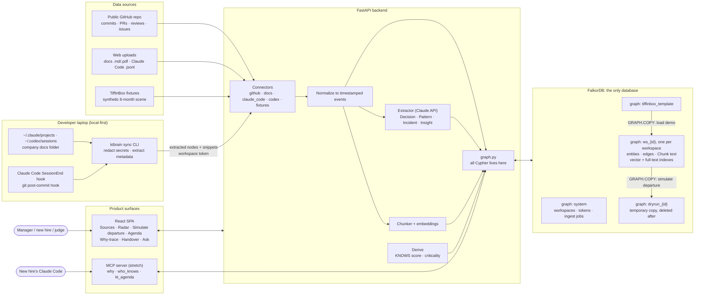
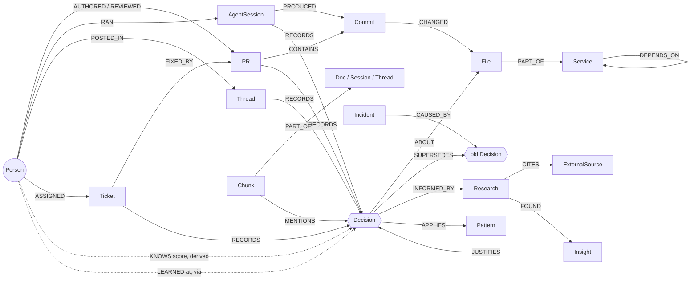

# KT Brain

**Knowledge transfer is a coverage problem, not a Q&A problem.**
KT Brain shows which knowledge is about to leave your company with a departing teammate, shows that nobody else has a recorded copy of it, and counts the handover down to zero.

> Built for **WeMakeDevs × FalkorDB "Graph Hacks: Context for AI Agents"** (Oct 15–18, 2026).
> Tracks: **03 Company Brain** · **02 Agent Memory & Coordination** · (01 Agents That Act on Connected Data, if the MCP server ships)
> Status: 🚧 in progress. Setup steps and live URL will be added as they land.

---

## The problem

When a developer leaves a startup, the team does **KT (knowledge transfer)**. Sometimes it's a one-hour call, sometimes a few weeks, depending on how busy both people are. After a layoff, it's often a rushed call on the last day.

Six months later, the new developer changes a payment retry count from 7 to 3 and payments start failing. The reason it was 7 was spread across a Slack thread, a ticket and a Claude Code session that nobody remembered.

**KT fails because nobody knows what's missing.** A chatbot can answer the questions you think to ask. It can't tell you which questions you didn't know to ask.

- 68% of developers hit a knowledge silo at least once a week ([Stack Overflow 2022](https://stackoverflow.blog/2022/06/22/asked-and-answered-the-results-for-the-2022-developer-survey-are-here/)).
- Newcomers take considerable time to match a departing core developer, and more orphaned code goes with more defects ([arXiv 2207.12851](https://arxiv.org/pdf/2207.12851)).

## The idea

KT Brain starts recording **from the first day** a person joins, not at their exit interview. Commits, PRs, reviews, tickets, docs, design decisions, incident write-ups, product research and **AI coding sessions** (Claude Code, Codex) all go into a **FalkorDB knowledge graph**. When someone leaves, nothing has to be pulled out of them at the last minute, because the graph already holds it.

| | What it does | How the graph does it |
|---|---|---|
| 1 | **Who knows what**: bus-factor radar while everyone is still here | Derived `KNOWS` edges; services and decisions with exactly one knower |
| 2 | **Dry-run a departure** before it happens | `GRAPH.COPY` the workspace, deactivate the leaver on the copy, list everything with **zero other knowers**. That list is the KT agenda |
| 3 | **Why-trace**: "why is `retries = 7`?" | A cited path: file ← commit ← AI session ← ticket ← Slack thread, with research links |
| 4 | **Handover tracker** | KT sessions and the new hire's PRs add `LEARNED` edges; the agenda counts **N → 0** |
| 5 | **Inheritance** (stretch) | The new hire's coding agent calls `why(path)` over MCP before editing a file |

It also flags **combination risk**: knowledge that is safe while either of two people stays, but disappears if both leave.

---

## The demo: TiffinBox (a synthetic startup)

TiffinBox is a fictional meal-subscription startup with one person per function. Its **6 months of history** (Apr → Sep 2026) are synthetic, written from a story bible that has a planted answer key (`COMPANY-X-SCENARIO.md`).

| Person | Role | Fate |
|---|---|---|
| Kavya | Frontend | stays |
| Arjun | Backend (payments, orders, auth) | **resigns** |
| Priya | DevOps (CI/CD, Terraform, secrets, backups) | **resigns** |
| Rohan | AI/ML (recommendations, ETA model) | stays |
| Neha | Product manager (PRDs, research, ADRs) | stays |
| Meera | New backend developer | **joins** for a one-week overlap |

The history covers four kinds of knowledge:
- **Code history**: commits, PRs and reviews across `web/`, `api/`, `infra/`, `ml/` and `docs/`.
- **Failure → research → improvement**: a checkout outage after an all-at-once deploy leads to research (citing Cloudflare's public [2 Jul 2019 outage report](https://blog.cloudflare.com/details-of-the-cloudflare-outage-on-july-2-2019/)) and then to **canary deploys**. Untested backups lead to research (citing GitLab's public [31 Jan 2017 incident](https://about.gitlab.com/blog/2017/02/10/postmortem-of-database-outage-of-january-31/)) and then to **quarterly restore tests**.
- **System design patterns**: retry with backoff, idempotency keys, optimistic locking, canary release, fallbacks.
- **PM ground research**: interviews → insight ("most trips are under 2 weeks") → PRD → a 2-week pause cap → `billing.py`.

**The scene:**
1. **Play**: 6 months replay into the graph in about 20 s. The radar shows infra = Priya only and payments = Arjun only.
2. **Arjun and Priya resign**: the dry run shows *N items with no recorded backup*.
3. **Toggle "Arjun only" / "Priya only" / "both"**: the gateway-key rotation (D8) appears **only when both leave**.
4. **An LLM that reads every document is asked the same question**: it misses D8, flags a decision the PM had already documented, and cites no proof. *Search can't prove that nobody else knows something. A graph query can.*
5. **Click the retry decision**: a cited path back to the Slack thread.
6. **Meera joins**: `LEARNED` edges are added, and the counter drops from N to 6.
7. **6 DevOps items remain**: KT Brain suggests a mentor (Kavya, a weak backup) or hiring. *The graph just wrote the hiring req.*

You can also **bring your own data**: paste a public GitHub repo URL, upload docs, or upload Claude Code session logs, and the same engine runs on it.

---

## Architecture



**FalkorDB is the only database:**
- **Multi-tenancy:** each workspace is its own graph.
- **Demo:** each visitor gets a `GRAPH.COPY` of the template, so one judge can't break the demo for the next.
- **Departures** are simulated on a throwaway copy, so the live graph is never touched.
- **Text** is stored as `Chunk` nodes with vector and full-text indexes. Search lands on a chunk and then walks the graph to the people, decisions and files around it.
- **Size:** logs are slimmed before storage (prompts, assistant text, file paths, branch, timestamps), and original files are not kept.
- **App metadata** (workspaces, tokens, jobs) lives in a small `system` graph.

### Graph data model



**Knowledge score.** `KNOWS` is derived from activity, never typed in by hand, and fades with age:

```
score(person, thing) = Σ weight(event type) · exp(−age_days / 180)
weights: decision 3.0 · authored PR 1.5 · review 1.0 · AI session 1.0 · thread 0.5 · typo commit 0.1
```

Scores below a threshold don't count, so dependency bumps and typo fixes don't make someone an "expert".

**The core query** (the KT agenda, run on the dry-run copy):

```cypher
MATCH (l:Person {id:$leaver})-[:KNOWS]->(k)
WHERE NOT k:Decision OR k.status = 'active'
OPTIONAL MATCH (o:Person {active:true})-[:KNOWS|LEARNED]->(k) WHERE o <> l
WITH k, count(o) AS backups WHERE backups = 0
RETURN labels(k)[0] AS kind, k.id, k.criticality ORDER BY k.criticality DESC
```

Every Cypher query the product uses will be listed here from `backend/graph.py` as it is written.

---

## Capturing AI coding sessions and local docs

| Way in | How it works |
|---|---|
| **Web upload** | Drag in `.md`/`.pdf` docs or Claude Code `.jsonl` sessions |
| **`ktbrain sync` CLI** | Reads `~/.claude/projects/*/*.jsonl`, `~/.codex/sessions/**`, and a docs folder. Keeps only sessions for this repo and **removes secrets on your laptop**. Sends only the extracted facts and short snippets; raw logs never leave the machine |
| **Automatic** | A Claude Code `SessionEnd` hook, or a git `post-commit` hook, runs the sync |
| Cursor | Planned (its chat storage format is undocumented and changes often) |

Each Claude Code log line carries `sessionId`, `cwd`, `gitBranch` and `timestamp`, and its edit tools record `file_path`. A session is linked to the commit it produced by overlapping files, matching branch and time window.

---

## How we're different

Most tools in this space **answer questions about knowledge**. KT Brain **finds the knowledge nobody else has, before it leaves, and tracks the handover until it's closed.**

| | Glean | Unblocked | Viven | CodeScene | **KT Brain** |
|---|---|---|---|---|---|
| Core idea | search company knowledge | answer "why" for devs and agents | query an AI twin of an absent coworker | code-ownership risk from code analysis | **measure and close the KT gap** |
| Answers questions you ask | yes | yes | yes | no | yes (cited why-trace) |
| Finds what you **didn't know to ask** (only-one-knower list) | no | no | no | partly (code only) | **yes, as a graph query** |
| Dry-run a departure before it happens | no | no | no | yes (code only) | **yes, across code, decisions, research and AI sessions** |
| Combination risk (only lost if *two* people leave) | no | no | no | not shown | **yes** |
| The *why* behind code as a cited path | partly | yes | yes | no | **yes** |
| AI coding sessions as a knowledge source | no | not shown | not shown | no | **yes** |
| Tracks the handover to zero | no | no | no | no | **yes (`LEARNED`, N → 0)** |
| Hands the leaver's reasoning to the successor's coding agent | no | for agents in general | no | no | **yes, via MCP (stretch)** |

Sources: [Viven (TechCrunch)](https://techcrunch.com/2025/10/15/eightfold-co-founders-raise-35m-for-viven-an-ai-digital-twin-startup-for-querying-unavailable-coworkers), [Unblocked](https://www.stackpick.net/pricing/unblocked/), [CodeScene off-boarding simulator](https://codescene.io/docs/guides/simulations/offboarding-simulator.html). "No" or "not shown" means we didn't find the feature on public pages, not that it doesn't exist. We found no product that combines all of these. We don't claim to be the first to do any single one of them.

**Why it needs a graph.** KT Brain can't work without FalkorDB:
- **Coverage queries.** "Zero other knowers" and combination risk are graph queries; text search can't prove that something is absent.
- **Dry runs.** `GRAPH.COPY` makes them cheap and safe.
- **Why-traces.** These are path queries across five or more node types.
- **Tenancy.** One graph per workspace.

---

## Tech stack

| Layer | Choice |
|---|---|
| Database | **FalkorDB** (Docker locally, FalkorDB Cloud in production) |
| Backend | Python, FastAPI |
| Extraction | Claude API: turns docs, sessions and PRs into Decision / Pattern / Incident / Insight nodes. Demo extractions are cached, so the demo needs no API key |
| Frontend | React + Vite, force-directed graph view |
| CLI | `ktbrain` (Python, single file) |

## Privacy

- **Permissions:** answers are filtered to what the person asking could already see.
- **Local-first:** with the CLI, raw logs stay on your laptop, and secrets are removed before anything is sent.
- **Careful wording:** KT Brain says "no recorded evidence anyone else knows this", never "nobody knows this".

## Data notice

TiffinBox and its people, messages, tickets and sessions are **synthetic**. The external postmortems it cites are real, public documents. Bring-your-own-repo mode uses only public GitHub data or data the user uploads.

## AI-assistance disclosure

This project was planned and built with help from Claude Code (Anthropic). The TiffinBox fixtures were expanded by Claude from hand-written story beats, and every artifact behind the answer key was checked by hand. The core logic (Cypher queries, the knowledge score, dry-run and agenda logic) is written by us. AI sessions are exported to `docs/ai-log/`.

## Setup

_Coming as the build progresses: `docker compose up`, seed the TiffinBox template, open the app._
